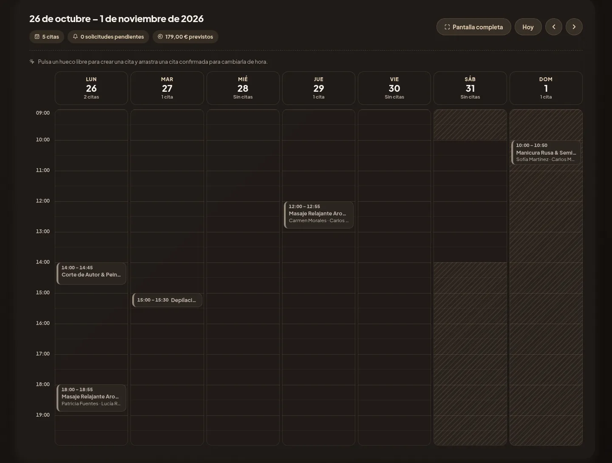
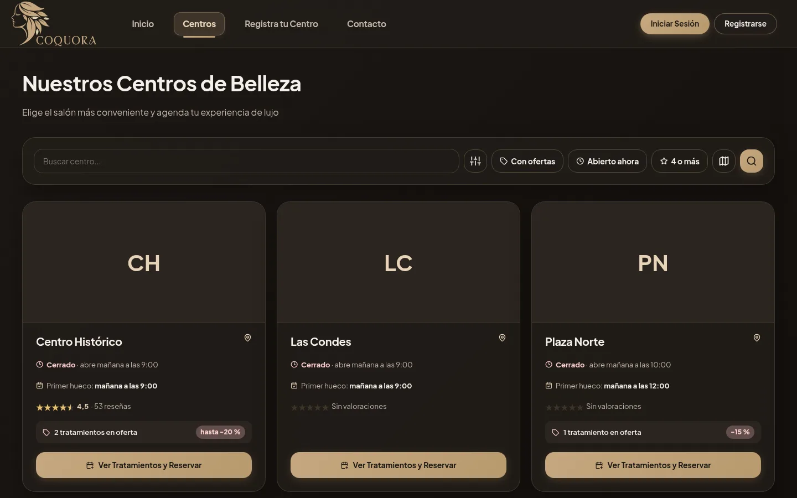

# Cuquora

Agenda, fichas de clientes e inventario para centros de belleza, con un buscador donde los clientes encuentran el centro y piden cita.



Un centro de estética suele llevar las citas en una libreta o en WhatsApp, las fichas en papel y el stock de memoria. Cuquora junta todo eso en una web que funciona igual en el ordenador de recepción y en el móvil de quien está en cabina.

Tiene dos lados. El equipo del centro entra a su panel y gestiona el día a día; los clientes buscan centros, ven los huecos libres y reservan sin llamar por teléfono.

La aplicación está en español y en beta (0.9.0). La 1.0 llegará cuando se abra al público en cuquora.com.

## Para el centro

**Agenda.** Vista de mes y de semana, citas que se mueven arrastrándolas y bloqueos para descansos o cierres. Cada centro define su horario, con jornada partida si la tiene, y cuántas citas caben a la vez según sus cabinas.

**Solicitudes.** Cuando un cliente pide cita, se acepta, se rechaza o se le proponen hasta tres horas distintas. Si el centro quiere, las reservas en huecos libres se confirman solas.

**Clientes.** Cada cliente tiene una ficha técnica con los campos que decida el centro, y su historial de citas. Después de cada tratamiento se puede escribir un resumen interno; si incluye un aviso, como una alergia, sale arriba en la ficha y en sus próximas citas.

**Inventario y ventas.** Stock por centro y venta de productos desde la ficha del cliente, descontando unidades y avisando cuando quedan pocas.

**También hay:**

- ofertas por tratamiento, con precio y fecha de fin
- tarjeta de puntos configurable, por euro gastado o por servicio
- análisis de ingresos, visitas y clientes que han dejado de venir, exportable a CSV
- gestión del equipo con invitaciones por correo y permisos de dueño o trabajador
- reseñas con respuesta del centro
- enlace corto y cartel con QR para el mostrador

## Para los clientes



El buscador tiene listado y mapa, con filtros para centros abiertos ahora, con ofertas o con buena nota. Solo se ofrecen las horas en las que el tratamiento cabe entero.

Desde «Mis citas» se ve lo reservado, se responde a una propuesta del centro y se consultan los puntos. Las reseñas solo se pueden escribir tras una cita completada, así que todas vienen de alguien que ha ido. Un día antes de la cita llega un recordatorio por correo.

## Cómo va una cita

```
                  ┌─> Confirmada ─┬─> Completada
Solicitud ────────┤               ├─> No se presentó
                  │               └─> Anulada
                  ├─> Propuesta (otras horas) ─> Confirmada o anulada
                  └─> Rechazada
```

Las citas que crea el propio centro nacen confirmadas. Las horas propuestas quedan reservadas mientras el cliente decide y caducan si no contesta.

## Probarlo en local

Hace falta JDK 21 y Maven. Con el JDK 27, Lombok no compila.

```bash
git clone https://github.com/Alexxlpz/CRM_CBelleza.git
cd CRM_CBelleza
mvn spring-boot:run -Dspring-boot.run.profiles=dev
```

La aplicación queda en <http://localhost:8080>. El perfil `dev` usa H2 en memoria, así que los datos se borran en cada reinicio, y carga centros y clientes de ejemplo. En <http://localhost:8080/login-selector> se puede entrar como cualquiera sin contraseña; si prefieres el formulario normal:

| Cuenta | Correo | Contraseña |
| --- | --- | --- |
| Dueño de centro | `carlos@cbelleza.com` | `Cuquora2026!` |
| Trabajadora | `lucia.romero@cbelleza.com` | `Cuquora2026!` |
| Cliente | `sofia@gmail.com` | `Cuquora2026!` |

Sin SMTP configurado, los correos se escriben en la consola. Es la forma de ver los enlaces de invitación y de alta de centro mientras se desarrolla.

```bash
mvn test
```

Para levantar todo en Docker (app, API de productos y PostgreSQL) con el perfil `dev`, en IntelliJ basta con el botón «Cuquora en Docker» (carpeta `.run/`); por consola:

```bash
docker compose -p cuquora-local -f docker-compose.yml -f docker-compose.local.yml up --build
```

Queda en <http://localhost:8090>, con el selector de perfiles y los datos de ejemplo, y no choca con los contenedores de producción. Hace falta `PRODUCT_API_KEY` en el `.env` (`openssl rand -hex 32`).

## Desplegar con Docker

```bash
cp .env.example .env    # rellenar con los valores reales
docker compose up -d --build
```

Levanta la aplicación, la API de productos (`product-api/`) y PostgreSQL 16. Si falta una variable obligatoria, `docker compose` se para y dice cuál. Por defecto arranca con el perfil de producción, que espera HTTPS delante; para probarlo en local por `http://` hay tres líneas que descomentar, explicadas en [`.env.example`](.env.example).

Cada variable está comentada en ese mismo fichero. El correo, el inicio de sesión con Google y la sincronización con Google Calendar son opcionales: sin sus credenciales, esas funciones quedan apagadas. La de Calendar todavía no se ha probado con una cuenta real de Google.

## Tecnología

Java 21, Spring Boot 4 (MVC, Security, Data JPA, Mail) y Thymeleaf. PostgreSQL en producción, H2 en desarrollo y tests, y Flyway para las migraciones.

La API de productos (`product-api/`) es un segundo Spring Boot en su propio contenedor: guarda nombre, descripción, categoría y foto de cada producto por su código de barras, se llena con lo que dan de alta los centros y, si no conoce un código, lo busca en Open Beauty Facts. Solo la llama la app, con clave y por la red interna de Docker; su [README](product-api/README.md) tiene los endpoints.

El front es CSS propio y JavaScript sin framework, con iconos Lucide servidos desde la propia aplicación, mapas de Leaflet con OpenStreetMap y ZXing para leer códigos de barras con la cámara donde el navegador no trae lector propio.

```
src/main/java/com/alexxlpz/crm_cbelleza/
  booking/         horarios y comprobación de si cabe una cita
  controllers/     uno por área, sin lógica de negocio
  services/        reglas de negocio y validación
  entities/        modelo JPA
  security/        login, roles y permisos del dueño
  mail/            correos de citas, invitaciones y altas
  googlecalendar/  sincronización de citas
  scheduler/       citas terminadas, propuestas caducadas y recordatorios
src/main/resources/
  db/migration/    esquema (Flyway)
  templates/       vistas de cliente, trabajador y correos
  static/          CSS y JS por pantalla
```

Dos decisiones que condicionan casi todo el código:

Cada centro solo ve lo suyo. Las rutas de trabajador sacan el centro de la sesión y no de la URL, y un recurso de otro centro responde 404. `CenterIsolationTests` lo comprueba.

Todos los cambios de una cita pasan por `BookingService`, que bloquea por centro para que dos personas no puedan quedarse el mismo hueco.

## Qué falta

Packs y bonos, vender escaneando el código de barras, recordatorios por WhatsApp y una pasada de limpieza visual a parte de la interfaz. Los cambios de cada versión están en [`CHANGELOG.md`](CHANGELOG.md).

La carpeta [`documentación/`](documentación/index.html) tiene una guía por roles y un manual de uso en HTML.

## Licencia

El repositorio no incluye licencia por ahora, así que el código no se puede reutilizar sin permiso de su autor, [Alexxlpz](https://github.com/Alexxlpz).
